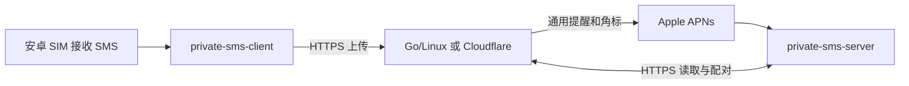

# SMS Forward Solutions

自托管的 **Android SMS → iPhone 收件箱与推送**方案，提供 Android、iOS、Go/Linux 和 Cloudflare 四部分完整源码。适合个人或小范围邀请使用。

Self-hosted Android-to-iPhone SMS forwarding with native apps, a Go/Linux backend, and a Cloudflare Workers backend. Documentation is primarily in Chinese.

> 本仓库是可自行部署的源码，不提供公共短信服务、共享读取令牌或 Apple 签名密钥。示例中的 `sms.example.com` 和 `com.example.privatesms` 必须替换为你自己的域名和唯一 Bundle ID。不要把短信上传到你不信任的服务。

## 工作方式



iPhone App 名叫 `private-sms-server`，实际是接收客户端；真正的后端运行在 Linux 或 Cloudflare。

- 安卓转发开关、一次性配对码/扫码、短信权限引导、加密本地队列、失败重试。
- 每账户一台安卓发送端、一台 iPhone 推送接收端；独立令牌、收件箱和设备绑定。
- iPhone 列表、详情、验证码复制、未读粗体/提示点、逐条已读与角标、删除和清空。
- 后端加密存储；推送不携带号码、短信正文、验证码或短信 ID。
- Android 8.0+、iOS 17+。只处理开启转发后新收到的 SMS，涵盖所有 SIM；不读取系统历史短信，不支持 RCS、彩信、通话或 iOS 发出短信。

## 选择部署版本

| 功能 | Go / Linux | Cloudflare 免费版 |
| --- | --- | --- |
| 运行环境 | 自有主机，Go 单进程 + HTTPS 代理 | Workers + 一个 SQLite Durable Object |
| 账户与配对 | 管理员创建读取令牌；可选 Apple 登录 + 邀请码 | 管理员创建读取令牌 |
| 短信 / 已读 / APNs | 支持 | 支持 |
| 默认保留 | 7 天，最多 5,000 条/账户 | 7 天，最多 500 条/账户 |
| 容量定位 | 单实例、小规模使用 | 最多 10 账户、全站 500 条新短信/天 |
| Apple 自助开通 | 可选，需单独配置 | 不支持 |
| SMSForwarder Webhook 表单 | 支持 | 不支持，使用本仓库安卓 App |
| 文件分享实验代码 | 包含，非短信主流程 | 不包含 |
| APK 固定下载 | `/download/android.apk` | Workers Static Assets，同一路径 |

两个后端兼容手机端的短信/配对接口；切换需要目标服务的读取令牌和重新配对，账户及历史不会自动迁移。Cloudflare 不依赖 Linux，也不需要 R2、Containers、Queues 或外部推送中转。免费计划及应用配额不是无限可用保证；Apple Developer、域名、SIM 和网络费用不在免费托管范围内。

### Apple 登录与 Apple 推送不是同一件事

两版都支持 iPhone 推送。区别是开通和恢复账户：Linux 可给朋友一个单次邀请码，让其用 Apple 账户开通/再次登录；Cloudflare 精简版由管理员创建账户，朋友在 iPhone 输入自己的读取令牌，换机时再次输入令牌。这是本项目第一期的功能取舍，不是 Cloudflare 免费计划禁止 Apple 登录。

## 从零开始

1. 准备可接收 SMS 的安卓手机、iPhone；自行编译 iOS 需要 macOS、完整 Xcode 和 Apple 开发者配置，TestFlight/APNs 需相应开发者权限。
2. 选择后端：[Cloudflare 部署](docs/cloudflare.md) 或 [Go/Linux 部署](docs/linux.md)。
3. 按 [iOS、APNs 与 TestFlight](docs/ios.md) 创建自己的 App ID、推送密钥并编译 iOS。
4. 按 [安卓编译与安装](docs/android.md) 生成并安装自己的 APK。
5. 按 [配对、切换和真机验收](docs/usage.md) 连接同一服务，验证 App 内测试消息、真实 SMS、锁屏通知与逐条已读。
6. 用 [运维与备份](docs/operations.md) 设置备份及更新流程；推荐别人使用前，为其创建独立账户。

2026-10-09，维护者确认三星 → Cloudflare → iPhone 的切换与真机测试通过。这是一次实际部署的验收记录，不保证所有机型、运营商和系统后台策略都相同。

## 项目结构

```text
android/       Kotlin Android 发送端及测试
ios/           SwiftUI iPhone 接收端、Xcode 工程及状态测试
server/        Go 后端、测试及文件分享实验静态资源
cloudflare/    TypeScript Worker、SQLite Durable Object、测试和管理脚本
deploy/        systemd、Nginx/Caddy 示例及 Linux 安装脚本
scripts/       Linux 打包、配对辅助和文件分享测试
docs/          构建、配置、协议、隐私与维护文档
```

## 本地检查

Go 1.24+、Node.js 24、JDK 17、Android SDK 35；iOS 使用完整 Xcode。

```sh
go test -race ./...
go vet ./...
node scripts/tests/share-crypto.mjs
cd cloudflare
npm ci
npm run check
npm test
npm run build
```

安卓与 iOS 命令见对应文档。GitHub Actions 只编译和测试，不读取生产密钥、不部署后端、不上传短信，也不签发手机安装包。

## 隐私与已知限制

**短信不是端到端加密**：服务器运营者及运行环境能解密短信，Cloudflare 部署由 Cloudflare 处理 HTTPS 请求。不要把“自托管”理解为运营者无法读取。

APNs 尽力交付，网络、专注模式和系统策略可能延迟通知；打开 App 主动同步是恢复路径。安卓必须开机、联网、允许短信及后台运行。限额或断网时会积压，解除配对会删除本机队列。完整边界见 [安全说明](SECURITY.md)。

## 开源与参与

采用 [MIT](LICENSE)。第三方库保留其原始许可，见 [THIRD_PARTY_NOTICES.md](THIRD_PARTY_NOTICES.md)。提交问题前请删除手机号、验证码、短信内容和令牌。贡献流程见 [CONTRIBUTING.md](CONTRIBUTING.md)，仓库设置建议见 [GitHub 维护说明](docs/github.md)。
